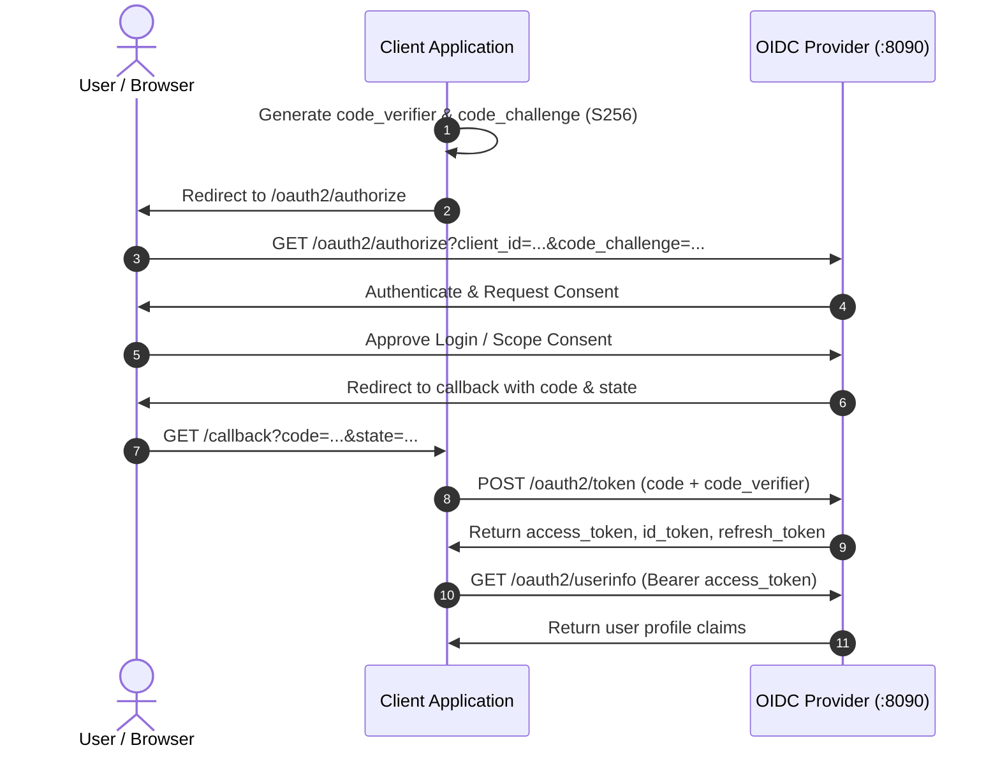

# Client OpenID Connect (OIDC) Integration Guide

This guide provides complete instructions and ready-to-run examples for integrating Single Sign-On (SSO) and API authentication with this **OpenID Connect (OIDC) Identity Provider**.

---

## Table of Contents
1. [Overview & Server Endpoints](#1-overview--server-endpoints)
2. [Prerequisites: Obtaining Client Credentials](#2-prerequisites-obtaining-client-credentials)
3. [Authorization Code Flow with PKCE (Recommended for SPAs, Mobile & Web Apps)](#3-authorization-code-flow-with-pkce)
4. [Refreshing Access Tokens (`refresh_token` Grant)](#4-refreshing-access-tokens)
5. [Machine-to-Machine Authentication (`client_credentials` Grant)](#5-machine-to-machine-authentication)
6. [Fetching User Profile (`/oauth2/userinfo`)](#6-fetching-user-profile)
7. [Token Introspection & Revocation (RFC 7662 & RFC 7009)](#7-token-introspection--revocation)
8. [Validating Access Tokens in Resource Servers (Backend APIs)](#8-validating-access-tokens-in-resource-servers)
9. [Ready-to-Use Code Examples](#9-ready-to-use-code-examples)
   - [Vanilla JavaScript / SPA (with Web Crypto PKCE)](#a-vanilla-javascript--single-page-app)
   - [React / TypeScript](#b-react--typescript-example)
   - [Node.js / Express Backend](#c-nodejs--express-backend)
   - [Spring Boot Resource Server](#d-spring-boot-resource-server)
10. [Error Codes & Troubleshooting](#10-error-codes--troubleshooting)

---

## 1. Overview & Server Endpoints

All endpoints use standard OpenID Connect 1.0 and OAuth 2.0 specifications.

| Property / Endpoint | URL / Value | Description |
| :--- | :--- | :--- |
| **Issuer URL** | `http://localhost:8090` | Base identity provider issuer URI |
| **Discovery Metadata** | `GET /.well-known/openid-configuration` | Returns all supported endpoints and capabilities |
| **JWKS (Public Keys)** | `GET /.well-known/jwks.json` | Public RSA keys for verifying JWT signatures |
| **Authorization Endpoint** | `GET /oauth2/authorize` | Initiates user login and consent flow |
| **Token Endpoint** | `POST /oauth2/token` | Exchanges authorization codes or credentials for JWTs |
| **UserInfo Endpoint** | `GET /oauth2/userinfo`, `POST /oauth2/userinfo` | Returns authenticated user claims |
| **Token Introspection** | `POST /oauth2/introspect` | Validates token active status (RFC 7662) |
| **Token Revocation** | `POST /oauth2/revoke` | Revokes token and terminates session (RFC 7009) |

### Supported Scopes
- `openid` *(Required for OIDC)*: Issues an `id_token` containing user identity (`sub`, `iss`, `aud`, `exp`, `iat`).
- `profile`: Grants access to `name`, `preferred_username`, `picture`, `locale`, `zoneinfo`, `updated_at`.
- `email`: Grants access to `email`, `email_verified`.
- `phone`: Grants access to `phone_number`.
- `address`: Grants access to physical `address`.
- `offline_access`: Issues a `refresh_token` for long-term offline access.

### Supported Signing Algorithm
- **RS256** (RSA Signature with SHA-256). Verify signatures using keys from `/.well-known/jwks.json`.

---

## 2. Prerequisites: Obtaining Client Credentials

Before integrating your application, you must obtain client credentials from your Identity Provider (IdP) administrator or developer portal.

### Client Types
Choose the appropriate client type for your application architecture:

1. **Public Client** (Single Page Apps: React, Vue, Angular; or Native Mobile Apps):
   - Cannot securely store a client secret on end-user devices.
   - You will be issued a **`client_id`** only (no `client_secret`).
   - **PKCE (`code_challenge` / `code_verifier`) is mandatory** for all authorization requests.

2. **Confidential Client** (Server-rendered web apps or backends: Node.js, Spring Boot, Python, Go):
   - Securely runs on private servers where credentials cannot be extracted by users.
   - You will be issued a **`client_id`** and a **`client_secret`**.
   - Store the `client_secret` exclusively in server-side environment variables—**never expose it in client-side code or public repositories**.

### Information to Provide to the IdP Administrator
When requesting client credentials for your app, provide:
- **Application Name**: A friendly name displayed to users during login/consent (e.g., `Order Portal`).
- **Redirect URIs (Callbacks)**: Exact URLs where users will be redirected after authentication (e.g., `http://localhost:3000/callback`, `https://app.example.com/callback`).
- **Client Type**: Public (SPA/Mobile) or Confidential (Server backend).
- **Required Scopes**: The user data your application needs (e.g., `openid`, `profile`, `email`, `offline_access`).
- **PKCE**: Enabled by default and strongly recommended for all clients.

### Credentials You Will Receive
Once provisioned, you will receive:
- **`client_id`**: Public identifier for your app (used in authorize and token calls).
- **`client_secret`** *(Confidential clients only)*: Secret key used to authenticate your server to the token endpoint.

---

## 3. Authorization Code Flow with PKCE

The Authorization Code flow with **Proof Key for Code Exchange (PKCE)** is the gold-standard security flow for both SPAs and backend web applications.



### Step 1: Generate PKCE Parameters
1. **`code_verifier`**: A cryptographically random string (43 to 128 characters) using `[A-Z]`, `[a-z]`, `[0-9]`, `-`, `.`, `_`, `~`.
2. **`code_challenge`**: Base64URL-encoded SHA-256 hash of the `code_verifier`:
   $$\text{code\_challenge} = \text{base64url}(\text{SHA-256}(\text{code\_verifier}))$$
3. **`code_challenge_method`**: Always use `S256`.

### Step 2: Redirect User to Authorize Endpoint
Redirect the user's browser to:
```
http://localhost:8090/oauth2/authorize?
  response_type=code
  &client_id=YOUR_CLIENT_ID
  &redirect_uri=http%3A%2F%2Flocalhost%3A3000%2Fcallback
  &scope=openid%20profile%20email%20offline_access
  &state=xyzRandomState123
  &code_challenge=E9Melhoa2OwvFrEMTJguCHaoeK1t8URWbuGJSstw-cM
  &code_challenge_method=S256
  &nonce=nonceRandom456
```

#### Query Parameters
| Parameter | Required | Description |
| :--- | :--- | :--- |
| `response_type` | **Yes** | Must be `code`. |
| `client_id` | **Yes** | Your registered `clientId`. |
| `redirect_uri` | **Yes** | Exact redirect URI registered for your client. |
| `scope` | **Yes** | Space-delimited scopes, must include `openid`. |
| `state` | **Yes** | CSRF protection token generated by client. |
| `code_challenge` | **Yes** (if PKCE) | Base64URL-encoded SHA-256 hash of `code_verifier`. |
| `code_challenge_method` | **Yes** (if PKCE) | `S256`. |
| `nonce` | Optional | Random string passed into the `id_token` to prevent replay attacks. |

### Step 3: Handle the Callback
Once the user logs in and consents, the browser redirects back to your `redirect_uri`:
```
http://localhost:3000/callback?code=019315d1-code-abc&state=xyzRandomState123
```
1. Verify that `state` matches the value you saved in Step 2 (to prevent CSRF).
2. Extract the `code` parameter.

### Step 4: Exchange Authorization Code for Tokens
Send a `POST` request to `/oauth2/token` using either `application/x-www-form-urlencoded` or `application/json`:

```http
POST /oauth2/token HTTP/1.1
Host: localhost:8090
Content-Type: application/x-www-form-urlencoded

grant_type=authorization_code
&client_id=YOUR_CLIENT_ID
&client_secret=YOUR_CLIENT_SECRET
&code=019315d1-code-abc
&redirect_uri=http%3A%2F%2Flocalhost%3A3000%2Fcallback
&code_verifier=dBjftJeZ4CVP-mB92K27uhbUJU1p1r_wW1gFWFOEjXk
```
*(Omit `client_secret` if your client is registered as a public client).*

#### Success Response (HTTP 200)
```json
{
  "access_token": "eyJhbGciOiJSUzI1NiIs...",
  "token_type": "Bearer",
  "expires_in": 3600,
  "refresh_token": "eyJhbGciOiJSUzI1NiIs...",
  "id_token": "eyJhbGciOiJSUzI1NiIs...",
  "scope": "openid profile email offline_access"
}
```

#### Understanding the Tokens
- **`access_token`**: RS256 JWT used to authorize requests against API Resource Servers (e.g., `Authorization: Bearer <access_token>`).
- **`id_token`**: RS256 JWT containing identity claims. Decode and verify signature using JWKS.
- **`refresh_token`**: Used to obtain new access tokens when expired without prompting the user.

---

## 4. Refreshing Access Tokens

When an `access_token` expires, use the `refresh_token` to obtain a new token pair:

```http
POST /oauth2/token HTTP/1.1
Host: localhost:8090
Content-Type: application/x-www-form-urlencoded

grant_type=refresh_token
&client_id=YOUR_CLIENT_ID
&client_secret=YOUR_CLIENT_SECRET
&refresh_token=eyJhbGciOiJSUzI1NiIs...
```

### Response
```json
{
  "access_token": "eyJhbGciOiJSUzI1NiIs...",
  "token_type": "Bearer",
  "expires_in": 3600,
  "refresh_token": "eyJhbGciOiJSUzI1NiIs...",
  "id_token": "eyJhbGciOiJSUzI1NiIs...",
  "scope": "openid profile email"
}
```
> [!NOTE]
> The server implements **Refresh Token Rotation**. A new `refresh_token` is issued with each refresh request. Discard the old one and store the newly issued `refresh_token`.

---

## 5. Machine-to-Machine Authentication

For daemon scripts, microservices, or background batch jobs that interact without an end user:

```http
POST /oauth2/token HTTP/1.1
Host: localhost:8090
Content-Type: application/x-www-form-urlencoded

grant_type=client_credentials
&client_id=YOUR_CLIENT_ID
&client_secret=YOUR_CLIENT_SECRET
&scope=openid
```

### Response
```json
{
  "access_token": "eyJhbGciOiJSUzI1NiIs...",
  "token_type": "Bearer",
  "expires_in": 3600,
  "scope": "openid"
}
```

---

## 6. Fetching User Profile

Retrieve the authenticated user's profile claims using the `access_token`:

```http
GET /oauth2/userinfo HTTP/1.1
Host: localhost:8090
Authorization: Bearer <ACCESS_TOKEN>
```

### Response (HTTP 200)
```json
{
  "sub": "019315d1-1234-7abc-9876-000000000001",
  "name": "Jane Doe",
  "preferred_username": "janedoe",
  "email": "janedoe@example.com",
  "email_verified": true,
  "picture": "https://example.com/avatars/janedoe.png",
  "phone_number": "+15551234567",
  "address": "123 Main Street, Suite 400, Springfield",
  "locale": "en-US",
  "zoneinfo": "America/New_York",
  "updated_at": 1731405000
}
```
Claims returned depend strictly on the scopes granted during authorization (`profile`, `email`, `phone`, `address`).

---

## 7. Token Introspection & Revocation

### Token Introspection (RFC 7662)
Resource servers can query the provider to verify if a token is valid, unexpired, and active:

```http
POST /oauth2/introspect HTTP/1.1
Host: localhost:8090
Content-Type: application/x-www-form-urlencoded

token=eyJhbGciOiJSUzI1NiIs...
```

#### Active Response:
```json
{
  "active": true,
  "sub": "019315d1-1234-7abc-...",
  "client_id": "019315d1-8000-7abc-...",
  "iss": "http://localhost:8090",
  "exp": 1731408600,
  "iat": 1731405000,
  "scope": "openid profile email",
  "token_type": "Bearer"
}
```

#### Inactive Response:
```json
{
  "active": false
}
```

### Token Revocation (RFC 7009)
Log the user out and invalidate the token session:

```http
POST /oauth2/revoke HTTP/1.1
Host: localhost:8090
Content-Type: application/x-www-form-urlencoded

token=eyJhbGciOiJSUzI1NiIs...
```
Returns `HTTP 200 OK`.

---

## 8. Validating Access Tokens in Resource Servers

Backend APIs protecting resources should validate incoming JWT Bearer tokens locally for optimal performance.

### Step-by-Step Validation Rules
1. **Fetch Public Keys**: Cache the JWKS from `http://localhost:8090/.well-known/jwks.json`.
2. **Verify Signature**: Verify the signature against the matching `kid` in the JWKS using `RS256`.
3. **Verify Issuer (`iss`)**: Must equal `http://localhost:8090`.
4. **Verify Audience (`aud`)**: Must contain your `client_id` or expected resource identifier.
5. **Verify Expiration (`exp`)**: Check that `exp > current_timestamp_in_utc`.
6. **Verify Scopes**: Check that the `scope` string contains required permissions (e.g. `profile`).

---

## 9. Ready-to-Use Code Examples

### A. Vanilla JavaScript / Single Page App
Using standard Web Crypto API for PKCE without external dependencies:

```html
<!DOCTYPE html>
<html>
<head><title>OIDC Integration Example</title></head>
<body>
  <button id="loginBtn">Log In with SSO</button>
  <pre id="profile"></pre>

  <script>
    const OIDC_CONFIG = {
      issuer: "http://localhost:8090",
      clientId: "YOUR_CLIENT_ID",
      redirectUri: "http://localhost:3000/callback",
      scope: "openid profile email offline_access"
    };

    // 1. Helpers for PKCE
    function generateRandomString(length) {
      const charset = "ABCDEFGHIJKLMNOPQRSTUVWXYZabcdefghijklmnopqrstuvwxyz0123456789-._~";
      let result = "";
      const values = new Uint8Array(length);
      crypto.getRandomValues(values);
      for (let i = 0; i < length; i++) {
        result += charset[values[i] % charset.length];
      }
      return result;
    }

    async function sha256(plain) {
      const encoder = new TextEncoder();
      const data = encoder.encode(plain);
      return crypto.subtle.digest("SHA-256", data);
    }

    function base64UrlEncode(buffer) {
      let binary = "";
      const bytes = new Uint8Array(buffer);
      for (let i = 0; i < bytes.byteLength; i++) {
        binary += String.fromCharCode(bytes[i]);
      }
      return btoa(binary)
        .replace(/\+/g, "-")
        .replace(/\//g, "_")
        .replace(/=+$/, "");
    }

    // 2. Start Login Flow
    async function login() {
      const state = generateRandomString(32);
      const codeVerifier = generateRandomString(64);
      const challengeBuffer = await sha256(codeVerifier);
      const codeChallenge = base64UrlEncode(challengeBuffer);

      sessionStorage.setItem("oidc_state", state);
      sessionStorage.setItem("oidc_code_verifier", codeVerifier);

      const params = new URLSearchParams({
        response_type: "code",
        client_id: OIDC_CONFIG.clientId,
        redirect_uri: OIDC_CONFIG.redirectUri,
        scope: OIDC_CONFIG.scope,
        state: state,
        code_challenge: codeChallenge,
        code_challenge_method: "S256"
      });

      window.location.href = `${OIDC_CONFIG.issuer}/oauth2/authorize?${params.toString()}`;
    }

    // 3. Handle Callback
    async function handleCallback() {
      const params = new URLSearchParams(window.location.search);
      const code = params.get("code");
      const state = params.get("state");

      if (!code) return;

      const savedState = sessionStorage.getItem("oidc_state");
      const codeVerifier = sessionStorage.getItem("oidc_code_verifier");

      if (state !== savedState) {
        alert("State verification failed! Potential CSRF attack.");
        return;
      }

      // Exchange code for tokens
      const tokenResponse = await fetch(`${OIDC_CONFIG.issuer}/oauth2/token`, {
        method: "POST",
        headers: { "Content-Type": "application/x-www-form-urlencoded" },
        body: new URLSearchParams({
          grant_type: "authorization_code",
          client_id: OIDC_CONFIG.clientId,
          code: code,
          redirect_uri: OIDC_CONFIG.redirectUri,
          code_verifier: codeVerifier
        })
      });

      const tokens = await tokenResponse.json();
      localStorage.setItem("access_token", tokens.access_token);
      localStorage.setItem("refresh_token", tokens.refresh_token);

      // Clean URL
      window.history.replaceState({}, document.title, window.location.pathname);

      // Fetch UserInfo
      fetchUserInfo(tokens.access_token);
    }

    async function fetchUserInfo(accessToken) {
      const response = await fetch(`${OIDC_CONFIG.issuer}/oauth2/userinfo`, {
        headers: { Authorization: `Bearer ${accessToken}` }
      });
      const data = await response.json();
      document.getElementById("profile").textContent = JSON.stringify(data, null, 2);
    }

    document.getElementById("loginBtn").addEventListener("click", login);
    if (window.location.search.includes("code=")) {
      handleCallback();
    }
  </script>
</body>
</html>
```

---

### B. React / TypeScript Example
Using the industry standard [`oidc-client-ts`](https://www.npmjs.com/package/oidc-client-ts):

```typescript
// authConfig.ts
import { UserManager, UserManagerSettings } from "oidc-client-ts";

const settings: UserManagerSettings = {
  authority: "http://localhost:8090",
  client_id: "YOUR_CLIENT_ID",
  redirect_uri: "http://localhost:3000/callback",
  response_type: "code",
  scope: "openid profile email offline_access",
  post_logout_redirect_uri: "http://localhost:3000",
  automaticSilentRenew: true
};

export const userManager = new UserManager(settings);

// App.tsx
import React, { useEffect, useState } from "react";
import { userManager } from "./authConfig";

export const App = () => {
  const [user, setUser] = useState<any>(null);

  useEffect(() => {
    userManager.getUser().then((u) => setUser(u));
  }, []);

  const login = () => userManager.signinRedirect();
  const logout = () => userManager.signoutRedirect();

  if (!user) {
    return <button onClick={login}>Log In with OIDC</button>;
  }

  return (
    <div>
      <h2>Welcome, {user.profile.name}!</h2>
      <p>Email: {user.profile.email}</p>
      <button onClick={logout}>Log Out</button>
    </div>
  );
};
```

---

### C. Node.js / Express Backend
Confidential client exchanging code on the server:

```javascript
const express = require('express');
const axios = require('axios');
const app = express();

const OIDC_CONFIG = {
  issuer: 'http://localhost:8090',
  clientId: process.env.OIDC_CLIENT_ID,
  clientSecret: process.env.OIDC_CLIENT_SECRET,
  redirectUri: 'http://localhost:4000/callback'
};

// Route to initiate login
app.get('/login', (req, res) => {
  const authUrl = `${OIDC_CONFIG.issuer}/oauth2/authorize?` +
    new URLSearchParams({
      response_type: 'code',
      client_id: OIDC_CONFIG.clientId,
      redirect_uri: OIDC_CONFIG.redirectUri,
      scope: 'openid profile email offline_access',
      state: 'randomSessionState'
    }).toString();
  res.redirect(authUrl);
});

// OAuth2 Callback
app.get('/callback', async (req, res) => {
  const { code } = req.query;

  try {
    const tokenRes = await axios.post(`${OIDC_CONFIG.issuer}/oauth2/token`, 
      new URLSearchParams({
        grant_type: 'authorization_code',
        client_id: OIDC_CONFIG.clientId,
        client_secret: OIDC_CONFIG.clientSecret,
        code: code,
        redirect_uri: OIDC_CONFIG.redirectUri
      }), {
        headers: { 'Content-Type': 'application/x-www-form-urlencoded' }
      }
    );

    const { access_token, id_token } = tokenRes.data;

    // Fetch user details
    const userRes = await axios.get(`${OIDC_CONFIG.issuer}/oauth2/userinfo`, {
      headers: { Authorization: `Bearer ${access_token}` }
    });

    res.json({ user: userRes.data, tokens: tokenRes.data });
  } catch (err) {
    res.status(500).json({ error: err.response?.data || err.message });
  }
});

app.listen(4000, () => console.log('Client app listening on port 4000'));
```

---

### D. Spring Boot Resource Server
In your backend microservice `application.yml`:

```yaml
spring:
  security:
    oauth2:
      resourceserver:
        jwt:
          issuer-uri: http://localhost:8090
          jwk-set-uri: http://localhost:8090/.well-known/jwks.json
```

Security Configuration:
```java
@Configuration
@EnableWebSecurity
public class ResourceServerConfig {

    @Bean
    public SecurityFilterChain filterChain(HttpSecurity http) throws Exception {
        http
            .authorizeHttpRequests(authorize -> authorize
                .requestMatchers("/public/**").permitAll()
                .anyRequest().authenticated()
            )
            .oauth2ResourceServer(oauth2 -> oauth2.jwt(Customizer.withDefaults()));
        return http.build();
    }
}
```

---

## 10. Error Codes & Troubleshooting

When an error occurs, the provider returns a structured JSON error response:

```json
{
  "code": "OIDC_004",
  "message": "Invalid redirect_uri for this client",
  "status": 400,
  "path": "/oauth2/token",
  "timestamp": "2026-11-12T04:00:00.123456Z",
  "traceId": "019315d1-7abc-..."
}
```

### Common Error Codes Reference
| Error Code | HTTP Status | Meaning | Resolution |
| :--- | :--- | :--- | :--- |
| `OIDC_001` | 401 Unauthorized | Invalid client credentials | Verify `clientId` and `clientSecret`. |
| `OIDC_002` | 401 Unauthorized | Client is disabled | Contact admin to re-enable client. |
| `OIDC_003` | 404 Not Found | Client ID not found | Confirm client is registered. |
| `OIDC_004` | 400 Bad Request | Invalid or mismatched `redirect_uri` | `redirect_uri` in request must strictly match the registered URI list. |
| `OIDC_005` | 400 Bad Request | Unsupported `response_type` | Must be `code`. |
| `OIDC_006` | 400 Bad Request | Unsupported `grant_type` | Use `authorization_code`, `refresh_token`, or `client_credentials`. |
| `OIDC_007` | 400 Bad Request | Invalid authorization code | Code does not exist or was malformed. |
| `OIDC_008` | 400 Bad Request | Code already used | Authorization codes are single-use only. Restart authorization. |
| `OIDC_009` | 400 Bad Request | Code expired | Codes expire in 5 minutes (300 seconds). |
| `OIDC_010` | 400 Bad Request | Code client mismatch | The code was issued to a different `clientId`. |
| `OIDC_011` | 400 Bad Request | PKCE verification failed | `code_verifier` hash does not match initial `code_challenge`. |
| `OIDC_012` | 400 Bad Request | PKCE required | Client requires PKCE. Include `code_challenge`. |
| `OIDC_013` | 400 Bad Request | Invalid scope | Request at least one scope allowed for the client. |
| `OIDC_014` | 400 Bad Request | Public client restriction | Public clients cannot use `client_credentials`. |

---

## Need Further Help?
- Check server health and endpoint discovery: `curl http://localhost:8090/.well-known/openid-configuration`
- View public verification keys: `curl http://localhost:8090/.well-known/jwks.json`
